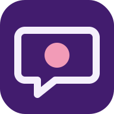

# Hanashimashō: Japanese for Clinicians



話しましょう (*hanashimashō*) means "let's talk." This web app teaches Japanese from zero to an English speaker, with a heavy focus on grammar and vocabulary, and then the psychiatric interview in Japanese. It is the Japanese sister app of [Usap Tayo](https://isaymotion.github.io/Tagalog/) (Tagalog) and Hablemos (Spanish) and runs on the same engine.

**App created by Isabella Navarro, MD. Latest version November 2026. isaymotion@gmail.com**

Version **0.21.0** (2026-11-16): the learn track with kanji study and stroke order, vocabulary and listening practice, the full interview, case simulations, the clinical tools and printable handouts. All Japanese is a **draft for review** by a native Japanese-speaking clinician.

## Reading aids

Every Japanese sentence in the app can show three helpers. Each has its own switch in **Settings → Reading aids** and under the **Aa** button, and all three are on at first.

| Aid | What it does | Switch |
|---|---|---|
| **Furigana** | The reading of every kanji in small hiragana above it | Always / On tap / Off |
| **Romaji** | A line of Latin letters under each sentence, and in brackets after single words | On / Off |
| **Spaces between words** | Japanese has no spaces; the app adds them so a beginner can see the words | On / Off |

Romaji follows the kana spelling (*ou*, *ei*, *uu*), with a macron only for the katakana long mark (コーヒー → *kōhī*). The particles は, へ and を are shown as *wa*, *e* and *o*.

## What's inside

| Section | What it does |
|---|---|
| **Lessons** | 189 grammar lessons with quizzes in 50 units, with a level filter (Starter 6, N5 47, N4 64, N3 24, N2 48); 24 of them are unit reviews. Since 0.24.0 three units of picture lessons (N5: places and bodies; clothes, town and signs; N4: machines and how things are) show their pictures inside the lesson. Starter and N5: Foundations (scripts, sounds, hiragana, katakana, how kanji work), First sentences, Numbers and time, Verbs, Adjectives, Likes, amounts and frequency (0.23.0), The te-form, Linking and nuance (0.23.0). N4: Plain forms, Saying more, Politeness and culture, Clinical Japanese, Clauses and descriptions, How things seem, Giving and receiving, More て-forms, Listing, conditions and time (0.23.0), Plans, advice and rules, Wishes, feelings and reported speech (0.23.0), Purpose and contrast, Degree, measure and compound verbs (0.23.0), Passive and causative, Respect language. N3: Time and sequence, Limits and extent, Causes and obligations, Conditions and relations, Contrast and concession, Hearsay and judgement, Feelings and attempts, Casual and written styles (understanding casual patient speech; reading chart and notice Japanese). N2 (0.21.0, first half of N2 grammar): Change and progress, Scope and range, Viewpoint and basis, Reasons and results, Possibility and limits, No choice and strong feeling, もの, こと and ところ, Comparison and surprise; each section says whether a form is to say or only to understand (many N2 forms are written or formal). N2 (0.22.0, second half): Timing and turning points, Contrast and supposition, Appearance and difficulty, Topic, dependence and addition, Advice, wishes and negative guesses, Emphasis and limits, Keigo, letters and chart style (with a labelled sample referral letter and progress note), Connectors and set phrases. Since 0.23.0 every N5 and N4 unit ends with a review lesson (a summary table, the commonest confusions, mixed examples and a quiz of 12), and each of the 56 older N5 and N4 lessons has three common mistakes (the wrong form struck through), six more examples and a "More practice" quiz of six. |
| **Kana trainer** | Hiragana and katakana charts with sound (basic 46, voiced, combinations), the stroke order of each kana (tap it on the chart), and a drill a row at a time: see the kana and choose the sound, see the sound and choose the kana, or listen and choose. Route `#/kana`. |
| **Kanji** | 1,049 kanji on a chart by level (80 at JLPT N5, 166 at N4, 367 at N3, 330 at N2, and a clinical set of 106 used in the psychiatry phrases; 37 of the clinical set are N2 kanji and the N2 chart links to them), grouped by theme. Each kanji has a page with meanings, on and kun readings, stroke count, a stroke-order diagram (numbered strokes, an animation, one stroke at a time, and a picture for each step), example words with furigana and sound, and more words from the dictionary. A drill a group at a time in four modes (kanji to meaning, meaning to kanji, word to reading, word to meaning), flashcard decks by level, and kanji links on every dictionary word page. A Stroke order button opens the diagram after each drill answer and on the back of every kanji flashcard (0.14.0). Route `#/kanji`. JLPT levels for kanji are approximate. |
| **Writing practice sheet** | A printable sheet for writing by hand: hiragana or katakana rows, kanji groups from any level, or any characters typed in. Each character has a numbered model, a picture for every stroke, grey characters to trace and empty squares; square size, rows, tracing and paper (A4 or Letter) can be chosen. Linked from every kanji page and from the stroke-order panel of the kana chart. Route `#/write` (`?set=h`, `?lv=N5`, `?c=食飲`). |
| **Verb and adjective trainer** | 528 verbs and 307 adjectives (N5 135, N4 244, N3 317, N2 66 and a clinical set of 73), with a level filter. For four verbs (死ぬ, 傷つける, 吐く, 賭ける) the forms that would sound like encouragement (let's, please, make or let, can) are never built (`HIDE` in `js/conjugate.js`). Each has a full table of forms made by rule (ます, ません, ました, て, ない, た, potential, volitional, たら, ば, passive, causative; adjective present, negative, past, て, adverb) and example sentences. Three drills: choose the form, name the form, type the form (kana or romaji). Route `#/verbs`. |
| **Particle drill** | A guide to 18 particles with examples, and 130 fill-in sentences. Route `#/particles`. |
| **Dictionary** | About 4,350 words with furigana (N5 about 700, N4 about 730, N3 about 1,640, N2 about 420; 682 words were added in 0.21.0 from the N2 kanji pages, clinical and advanced about 500), including every example word on the kanji pages, 72 N3 grammar patterns and ward and chart vocabulary. Search in kanji, kana, romaji or English; filter by topic, JLPT level or kana row. Verb and adjective entries show their conjugation. |
| **Flashcards** | Spaced repetition. Decks by topic, by JLPT level, by kanji level, by psychiatry section, and an automatic "My mistakes" deck. The back of a kanji card has a Stroke order button; the back of a vocabulary card has one button for each kanji in the word (0.15.0). |
| **Vocabulary quiz** (0.17.0) | `#/vocab`: any deck (level, topic, clinical, My mistakes) in five modes: Meaning, Recall, Reading (kanji without furigana → choose the kana), and since 0.23.0 In context (choose the word that fills the blank in its example sentence) and Type it (see the English, type the reading in kana or romaji). Matching (`?tab=match`): 52 topic sets (eight of N2 words since 0.22.0, ten of picture words since 0.24.0) with a level filter and a Quiz mode. Data `js/data/topic-sets.js` to `topic-sets-4.js`. |
| **Example sentences** (0.17.0) | 2,965 dictionary words (all N5, N4, N3 and N2 words except risk words; 0.22.0 added 401 for N2) have an example sentence on the word page and on the back of the word card. Data `js/data/examples-1..17.js`, keyed by the dictionary line's first two fields. |
| **Listening practice** (0.17.0) | `#/listen`: Hear (words, or lesson and example sentences, by level and speed), Dictation (kana tiles or typing in kana or romaji), Sound pairs (104 pairs, `js/data/sound-pairs.js`), Dialogues and readings (3 questions each on all 54, `js/data/listen-questions.js` and `-4.js`). |
| **Numbers and counters** (0.17.0) | `#/numbers`: 21 tables with sound changes marked, a Read / Listen quiz, and 40 clinic sentences to catch the number in. Data `js/data/counters.js`. |
| **Nurse-side practice** (0.18.0) | Case simulations played as the ward nurse (`role: 'nurse'` in `js/data/psych-cases-4.js`), nurse scripts in De-escalation and Discharge (`js/data/psych-nurse-tools.js`, Resident / Nurse switch), nurse pocket card (`#/psych/handout?nursecard=1`, A6). Pending Nursing Service review. |
| **New presentations** (0.18.0) | Simulations for OCD, PTSD, panic disorder and a 14-year-old not going to school, with her mother (`js/data/psych-cases-5.js`). |
| **Listening on cases, Progress scores** (0.18.0) | Questions on all 15 case simulations in Listening → Dialogues and readings (`js/data/listen-questions-2.js`, keys `case-<id>`); practice scores on the Progress page. |
| **New-patient cases, more nurse scripts** (0.19.0) | First-visit MSE cases for Takumi, Mariko, Daiki and Hinata (`js/data/psych-mse-cases-6.js`), Daiki's ED discharge (`psych-discharge-cases-6.js`); nurse views in the Mood checker and the MSE interviewer sheet (`psych-nurse-tools-2.js`, shared helper `js/nurse-script.js`); 44 nurse-section replies (`psych-answers-6.js`); 10 more topic sets (`topic-sets-2.js`); practice scores in the backup summary. |
| **End-of-treatment review, listening on cases, topics by level** (0.20.0) | End-of-treatment review practice for outpatients (`js/eot-practice.js`, form and section `eot` in `js/data/psych-eot.js`, cases for Takumi, Mariko and Hinata in `psych-eot-cases-1.js`; shares the discharge engine in `js/discharge-practice.js`); listening on the first-visit MSE cases and Daiki's discharge (`listen-questions-3.js`, keys `mse-<id>`, `dis-<id>`); 16 interpretation items (`psych-interp-3.js`); 10 topic sets (`topic-sets-3.js`); level filter and Quiz mode in topic matching (`js/vocab.js`). |
| **Picture words, signs and buttons** (0.24.0) | Picture words (`#/pictures`): 38 picture sets, 505 N5 and N4 words: 23 labelled line drawings (body, house, town, hospital floor, position words, car, bicycle, meal tray, clothes, landscape, family tree …) and 15 sets of emoji picture cards (animals, vehicles, ward things, food, colours, weather, feelings, daily routine …). Tabs: Learn, Identify, Label it (choose or type), Listen and point (378 recorded sentences), Print (labelling sheet with answer key). Body map (`#/pictures/bodymap`): the patient taps where it hurts; questions and pain words with sound; one-page handout; nothing stored. Signs and buttons (`#/signs`): 120 signs in seven groups shown without furigana, quiz both ways, and ten machine panels with tasks. Data `js/data/picture-sets-*.js`, `picture-bodymap.js`, `signs.js`, `signs-panels.js`; drawings in `pictures/art-*.js` (no Japanese; outside `js/data` so changing a drawing does not start the recording job). Modules `js/pictures.js`, `js/picture-print.js`, `js/signs.js`. |
| **Today's practice, Find the mistake, Listen and reply** (0.25.0) | `#/today`: a mixed round of 12 from every drill's mistakes (js/today.js, shared runner `App.drillRun`, best per day in `done.today`). `#/errors`: 200 sentences with one wrong word, tap it (js/errors.js; data `js/data/grammar-errors-*.js`; the wrong sentence is never spoken or recorded). `#/reply`: hear a line, choose the natural reply, 160 exchanges, half clinical (js/reply.js; data `js/data/listen-reply-*.js`). Listening questions on all 29 practice cases (`listen-questions-5.js`, `-6.js`; end-of-treatment stories `eot-<id>`). |
| **Grammar and word drills** (0.23.0) | Six practice pages, each with a best score per level on the Progress page and a "Practise my mistakes" round. Sentence builder (`#/build`): put the word tiles of a lesson or dictionary example sentence in order, by level. Fill the blank (`#/cloze`): 620 sentences (N5 124, N4 184, N3 120, N2 192), by level or by lesson, with the reason after each answer. Transform the sentence (`#/transform`): 250 items (N5 70, N4 90, N3 45, N2 45), negative, past, polite, joining, conditional, passive, keigo and more; choose the answer or type it. Level review test (`#/test`): a mixed test of one level (grammar, sentence order, vocabulary, kanji and a reading passage) with a result by area and links to what to review. Word pairs (`#/pairs`): 280 opposites, near-synonyms and collocations (70 per level from N5 to N2) to learn, match against the clock or quiz. Sound-symbolic words (`#/sounds`): 90 words such as ズキズキ and イライラ in 9 groups (pain, stomach, sleep, mood …), each with an example sentence, to learn, quiz and match. Lesson pages link to that lesson's Fill the blank set. Data `js/data/grammar-cloze-*.js`, `grammar-transform-*.js`, `word-pairs-*.js`, `sound-words.js`, `lesson-extra-*.js`. |
| **Reading** | 32 graded passages (Starter 2, N5 4, N4 7, N3 11, N2 8) with translations, glossaries and questions, a level filter and a Print button; 15 are clinical, including a letter with keigo, a casual chat, nursing notes in chart style and a formal ward notice. |
| **Speaking** | 22 dialogues (Starter 1, N5 6, N4 3, N3 6, N2 6) with a level filter and Listen, Shadow and Role-play modes, speech recognition where the browser has it, and record-and-compare. |
| **Placement test** | 30 questions from the kana to N2 that point to the right unit to start. |
| **Psychiatry Japanese** | 27 interview sections, 352 phrases, in the same order and with the same phrase numbers as Usap Tayo: opening, consent, chief complaint and HPI, depression, mania, anxiety, trauma, hallucinations, delusions, suicide risk, violence risk, de-escalation, substances, history, family history, social history, collateral, the MSE (cognition; abstraction, judgment and insight; describing observations), explaining diagnosis and treatment, medication, admission and discharge, children, elderly patients, closing, and Shea's validity techniques. Each phrase has a polite (です/ます) form and a plain form, with notes. Since 0.16.0 a **Resident / Nurse** switch on the Interview tab: the Nurse view shows six nurse sections (125 phrases: arriving on the ward, medicines and side effects, sleep, appetite and hygiene, safety checks for suicide risk and agitation, calming things down, teaching patients and families) and then the resident sections nurses use most; nurse content is pending Nursing Service review. The same switch drives the nurse scripts in the substance use and withdrawal tools. |
| **Case simulations** | 7 branching interviews (psychosis, depression with suicide risk, mania, delirium, alcohol withdrawal, an agitated patient, over-the-counter medicine misuse) with feedback on every choice and a findings summary. |
| **What is the patient saying?** | 32 idioms and indirect statements with their clinical meaning and the next question to ask. |
| **Clinical tools** | Mood episode checker (DSM-5-TR criteria as questions, PHQ-9 and MDQ interview paraphrases); substance use screen with severity, codes and a guided motivational interview; withdrawal and agitation guide (PAWSS, CIWA-Ar, COWS scorers, nurse script, practice cases); de-escalation checklist with drills; discharge assessment field by field. Nothing typed into a tool is saved. The forms are generic: set your hospital's name and form numbers in `data/hospital.js`. |
| **Practice with simulated patients** | Eight admission MSE cases (Shota, Ren, Ayaka, Yumiko, Tetsuo, Chiyoko; since 0.16.0 also Daisuke and Shigeru) and eight discharge cases (Shota, Yumiko, Ren, Tetsuo, Ayaka, Daisuke, Chiyoko; since 0.16.0 Shigeru), so each of the eight practice patients has a simulation, an admission case and a discharge case. Shigeru Yamada's delirium is seen by the psychiatry liaison team on a medical ward. Chiyoko Ito (0.15.0, 79, Alzheimer's disease with night wandering and a belief that her daughter-in-law steals from her) has a simulation since 0.16.0 (a joint interview with her son and daughter-in-law); her two cases teach ruling out delirium first and planning with the family. The fifth (0.13.0) is Ayaka Nakamura, over-the-counter medicine misuse: no discharge medicines, the household medicines locked away, an early outpatient appointment; no product names or doses. |
| **Printable handouts** | A handout builder (interview flow, key or full phrases by section, MSE table, "what the patient may be saying", de-escalation checklist, discharge guide, blank MSE form) with seven ready-made sets, including an A5 pocket booklet and an A6 de-escalation card; and the MSE interviewer sheet. Options for polite or plain form, English, furigana, romaji, paper and text size. Lessons, reading passages and the kanji list (Kanji → List) have a Print button too. Printing uses the browser's print window; choose "Save as PDF" there to make a PDF. Routes `#/psych/handout`, `#/psych/mse-sheet`. |
| **Point board** | The patient taps a reply, the phone speaks it and the interviewer reads the English. General replies, a 0 to 10 scale and likely replies for each section (314 replies). |
| **Listening drill** | Hear a patient reply, choose its meaning from four, then see the Japanese. |
| **You** | Streaks, XP, progress, backup export / import with undo, settings, What's New, About. |
| **Menu language** | Settings → Menu language (also on About): English or Japanese. In Japanese the menu, bottom tabs, footer, theme and text-size controls and the backup messages are in Japanese with furigana, and each menu item shows its English meaning underneath. Since 0.14.0 the page headings, the section headings on Home, Practice and Settings and the tile titles are in Japanese too, each with its English underneath (`head.<English text>` strings; `App.heads` in `js/app.js`). The strings are in `data/strings.js` (`tl`), in the same notation as the content; explanations and lesson text stay English. |


## Audio

The app plays recorded clips from `audio/` whenever they exist, and otherwise speaks with the Japanese voice already on the phone or computer (iPhone and iPad: Kyoko or an Enhanced voice under Settings → Accessibility → Spoken Content → Voices → Japanese; Android: Google Text-to-speech → Japanese; Microsoft Edge: Nanami, Keita). In the app, Settings → Voice shows whether the pack is installed, switches between the recorded voice and the device voice, and can save every clip for offline use.

## Audio pack (natural Japanese voice)

The clips are made by a GitHub Actions job (`.github/workflows/audio-pack.yml`) that records every Japanese string the app can speak (about 18,800, roughly 340 MB: dictionary words, lesson examples, readings, dialogues, kana, every form of the trainer's verbs and adjectives, kanji words, interview phrases in both registers, replies, cases and the clinical tools) with a Microsoft neural voice through the open-source `edge-tts` client: `ja-JP-NanamiNeural` (female, the default) or `ja-JP-KeitaNeural` (male).

- **To record or update:** the job runs by itself when files in `js/data/` change. To run it by hand: **Actions → Build Japanese audio pack → Run workflow** (choose the voice and the speed there; tick "Record every clip again" after changing either). One run records for up to 50 minutes; if clips are still missing it starts the next run by itself. The job commits `audio/` to `main`.
- **Files:** `audio/manifest.json` (voice, date, the list of clips), one `audio/<16-hex>.mp3` per string, `audio/voice-text.json` and `audio/last-run.json` (how the last run went). The pack is about 250 MB; the service worker does not download it in advance, it keeps each clip after its first play.
- **File names:** the hash of the text as the app speaks it, `AudioKey(JA.speak(text))` (`js/audio-key.js`). A few words are written the same but read differently (方 = かた / ほう, 一日 = いちにち / ついたち): the less common reading has a second clip named from the text plus its reading, and the app plays the one that matches the furigana.
- **Readings:** the voice is sent ordinary Japanese, but a voice can read a kanji differently from the furigana (何, 七時, 十分). So `tools/make_audio_pack.py` reads every string with a Japanese dictionary (MeCab + UniDic) and, where that reading differs from the furigana, sends those words in kana. The same is done for known homographs (方, 後, 他, 一日) and for the less common reading of any spelling the app reads in two ways. A blank (＿) is said as まるまる; stage directions in brackets are not read. `tools/voice-overrides.json` gives the exact text to send for a string where these rules read badly. What was sent is listed in `audio/voice-text.json`. To see the list without recording: `pip install fugashi unidic-lite`, then `python3 tools/make_audio_pack.py --report`.
- **Not recorded:** the conjugation table on a dictionary word page (the trainer's 528 verbs and 307 adjectives are recorded in every form). The device voice speaks those.
- **A line the app speaks that is in no data file** goes in `tools/extra-texts/<name>.txt`, one per line, in the app's notation.

The recordings are machine voices reading draft Japanese: a clip can still have a wrong reading or accent. When the furigana of that line is corrected in `js/data/`, the job records the clip again.

## Publish it with GitHub Pages

1. On GitHub, open the **Japanese** repository → **Settings → Pages**.
2. Under **Build and deployment**, choose **Deploy from a branch**, branch **main**, folder **/ (root)**, then **Save**.
3. After a minute the app is live at `https://isaymotion.github.io/Japanese/`.
4. On a phone, open that link, then use **Add to Home Screen** (iPhone Safari) or **Install app** (Android Chrome).

To try it locally: run `python3 -m http.server` in this folder and open `http://localhost:8000`.

## Files

```
index.html              shell: top bar, menu, footer, script list
css/style.css           design tokens (wisteria violet, hue 268) and all styles
js/ja.js                furigana, romaji and word-spacing support (read its header first)
js/conjugate.js         verb and adjective conjugation by rule
js/lang.js              language pack (voices, register labels, levels)
js/core.js              storage, dictionary, search, spaced repetition, speech
js/views.js             home, dictionary, flashcards, lessons, reading, speaking, placement, settings
js/kana.js              kana trainer
js/kanji.js             kanji chart, kanji pages and kanji drill (data: js/data/kanji-*.js)
js/strokes.js           stroke-order diagrams on kanji pages and the kana chart; the Stroke order button (kanji drill, kanji and vocabulary flashcards) and the tap-a-kana card under the hiragana and katakana lessons
js/writing.js           printable writing practice sheet (#/write)
js/vocab.js             vocabulary quiz and topic matching (#/vocab), 0.17.0
js/listen.js            listening practice: hear, dictation, sound pairs, dialogue and reading questions (#/listen), 0.17.0
js/numbers.js           numbers and counters (#/numbers), 0.17.0
js/build.js, cloze.js, transform.js, leveltest.js, pairs.js, soundwords.js   0.23.0 drills: sentence builder, fill the blank, transform, level test, word pairs, sound-symbolic words
strokes/*.js            stroke data for the kana and the 1,049 kanji, from KanjiVG (CC BY-SA 3.0; strokes/LICENSE.md); rebuilt by strokes/build-strokes.py
js/grammar.js           verb / adjective trainer and particle drill
js/psych-views.js       psychiatry hub and phrase sections
js/point-listen.js      point board and listening drill
js/mood.js, sud.js, withdrawal.js, deesc.js, discharge.js   clinical tools
js/mse-practice.js, discharge-practice.js                   practice with simulated patients
js/handout.js, mse-sheet.js                                 printable handout builder and MSE interviewer sheet (browser print, no PDF library)
js/app.js               routing, menu, theme, text size, reading aids, search, backup
js/data/*.js            all content
data/app-meta.js        name, version, attribution
data/changelog.js       What's New
data/hospital.js        hospital details (generic; fill in for your service)
data/strings.js         shell labels, English and Japanese (Settings → Menu language)
sw.js                   offline cache (prefix hanashimasho-)
manifest.webmanifest    install details
icons/                  app icons
tools/AUTHORING.md      how Japanese is written in the data files
tools/check-ja.js       checks the Japanese notation: node tools/check-ja.js
tools/collect-texts.js  lists every string the app can speak (tools/texts.json), for the audio pack
tools/make_audio_pack.py  records the audio pack (run by .github/workflows/audio-pack.yml)
audio/                  the recorded clips and their manifest (written by the workflow)
js/audio-key.js         file name of a clip from its text
```

## How Japanese is written in the data files

All content is plain JavaScript in `js/data/`, with no build step. Japanese uses one notation everywhere (full rules in `tools/AUTHORING.md`):

- The reading follows each kanji run in 《 》: `食《た》べます`, `日本語《にほんご》`.
- Words are separated by one space, particles on their own: `私《わたし》 は 医者《いしゃ》 です。`
- No romaji is typed; the app generates it.

After editing any data file run `node tools/check-ja.js`. It must report 0 errors (a kanji with no reading, a reading that is not hiragana).

- **Dictionary** (`dict-*.js`): `japanese | english | part of speech | category | level | note`. Parts of speech: `n v1 v5 vs vi ai an adv pron part conj interj num ctr q pre suf phr`.
- **Lessons** (`lessons-1.js` to `lessons-35.js`, `lessons-kanji.js`): `{ id, level, unit, title, summary, body (HTML), quiz }`; since 0.23.0 also `after: '<lesson id>'` (shown right after that lesson; `lessons-zz-order.js` sorts them in) and `review: true` (a unit review). Lesson extras (`lesson-extra-1.js` to `-8.js`): `LESSON_EXTRA[id] = { mistakes, more, quiz }`. Example boxes are `<div class="ex"><b>Japanese</b><span>English</span></div>`.
- **Verbs and adjectives** (`verbs.js`): dictionary form plus group (`ru`, `u`, `suru`, `kuru`) or type (`i`, `na`); the forms are generated.
- **Particles** (`particles.js`), **readings** (`reading.js`), **dialogues** (`dialogues.js`), **placement** (`meta.js`).
- **Psychiatry phrases** (`psych-phrases-1.js` to `-6.js`; nurse sections `-7.js`, `-8.js`, with `role: 'nurse'`): `P(english, polite, plain, note)`. Phrase numbers are IDs: append only, never insert or reorder. The display order of sections is `sectionOrder` in `js/lang.js`. **Patient replies**: `psych-answers.js` to `-5.js` (3 and 5: nurse sections). **Cases and the interpretation drill**: `psych-cases-1.js` to `-3.js`, `psych-interp-2.js`. **Technique links**: `psych-shea.js`.
- **Clinical tools** (`psych-mood.js`, `psych-sud.js`, `psych-withdrawal.js`, `psych-deesc.js`, `psych-discharge.js`, `psych-admit-mse.js`) and **practice cases** (`psych-mse-cases.js`, `-2.js`, `-3.js`, `psych-discharge-cases-1.js` to `-4.js`): same shapes as in Usap Tayo and Hablemos; each file's header describes its fields. Only the patient-facing lines are Japanese; criteria, scores and reference text are English.
- **What's New**: add an entry at the top of `data/changelog.js`, then set the same `version` in `data/app-meta.js` and `VERSION` in `sw.js`.

The service worker only deletes caches whose names start with `hanashimasho-`; never change that rule, because every isaymotion app shares the same site. Progress is stored in the browser under `hanashimasho.v1`.

## Stroke-order data and its licence

The stroke-order diagrams use data from [KanjiVG](https://kanjivg.tagaini.net), copyright (C) 2009-2011 Ulrich Apel, under the [Creative Commons Attribution-Share Alike 3.0](https://creativecommons.org/licenses/by-sa/3.0/) licence. The six data files in `strokes/` are an adaptation (paths copied, coordinates rounded) and are shared under the same licence; the rest of the app is not covered by it. Details: `strokes/LICENSE.md`. To rebuild after adding kanji: clone KanjiVG and run `python3 strokes/build-strokes.py <kanjivg folder> .`; it also reports any kanji whose stroke count in the app differs from KanjiVG (none at present).

## Important note on the content

The Japanese in this app was drafted with AI assistance and checked mechanically and by a second pass, but it has not yet been reviewed by a native Japanese-speaking clinician. Treat every section as a draft. Psychiatry phrases are practice phrasings written for training; they are not validated translations of research instruments (use the published Japanese versions where a scale is required). The cognitive questions are bedside items written for this app and do not reproduce copyrighted tests. For consent, risk assessment, diagnosis and treatment decisions, work with a qualified medical interpreter. No crisis line is preset: add the one your service uses in `data/hospital.js`.
