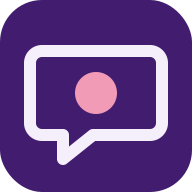

# Hanashimashō: Japanese for Clinicians



話しましょう (*hanashimashō*) means "let's talk." This web app teaches Japanese from zero to an English speaker, with a heavy focus on grammar and vocabulary, and then the psychiatric interview in Japanese. It is the Japanese sister app of [Usap Tayo](https://isaymotion.github.io/Tagalog/) (Tagalog) and Hablemos (Spanish) and runs on the same engine.

**App created by Isabella Navarro, MD. Latest version November 2026. isaymotion@gmail.com**

Version **0.11.0** (2026-11-13): the learn track with kanji study and stroke order, the full interview, case simulations, the clinical tools and printable handouts. All Japanese is a **draft for review** by a native Japanese-speaking clinician.

## Reading aids

Every Japanese sentence in the app can show three helpers. Each has its own switch in **Settings → Reading aids** and under the **Aa** button, and all three are on at first.

| Aid | What it does | Switch |
|---|---|---|
| **Furigana** | The reading of every kanji in small hiragana above it | Always / On tap / Off |
| **Romaji** | A line of Latin letters under each sentence, and in brackets after single words | On / Off |
| **Spaces between words** | Japanese has no spaces; the app adds them so a beginner can see the words | On / Off |

Romaji follows the kana spelling (*ou*, *ei*, *uu*), with a macron only for the katakana long mark (コーヒー → *kōhī*). The particles は, へ and を are shown as *wa*, *e* and *o*.

## What's inside

| Section | What it does |
|---|---|
| **Lessons** | 86 grammar lessons with quizzes in 26 units, with a level filter (Starter 6, N5 21, N4 35, N3 24). Starter and N5: Foundations (scripts, sounds, hiragana, katakana, how kanji work), First sentences, Numbers and time, Verbs, Adjectives, The te-form. N4: Plain forms, Saying more, Politeness and culture, Clinical Japanese, Clauses and descriptions, How things seem, Giving and receiving, More て-forms, Plans, advice and rules, Purpose and contrast, Passive and causative, Respect language. N3: Time and sequence, Limits and extent, Causes and obligations, Conditions and relations, Contrast and concession, Hearsay and judgement, Feelings and attempts, Casual and written styles (understanding casual patient speech; reading chart and notice Japanese). |
| **Kana trainer** | Hiragana and katakana charts with sound (basic 46, voiced, combinations), the stroke order of each kana (tap it on the chart), and a drill a row at a time: see the kana and choose the sound, see the sound and choose the kana, or listen and choose. Route `#/kana`. |
| **Kanji** | 719 kanji on a chart by level (80 at JLPT N5, 166 at N4, 367 at N3, and a clinical set of 106 used in the psychiatry phrases), grouped by theme. Each kanji has a page with meanings, on and kun readings, stroke count, a stroke-order diagram (numbered strokes, an animation, one stroke at a time, and a picture for each step), example words with furigana and sound, and more words from the dictionary. A drill a group at a time in four modes (kanji to meaning, meaning to kanji, word to reading, word to meaning), flashcard decks by level, and kanji links on every dictionary word page. Route `#/kanji`. JLPT levels for kanji are approximate. |
| **Verb and adjective trainer** | 100 verbs and 60 adjectives. Each has a full table of forms made by rule (ます, ません, ました, て, ない, た, potential, volitional, たら, ば, passive, causative; adjective present, negative, past, て, adverb) and example sentences. Three drills: choose the form, name the form, type the form (kana or romaji). Route `#/verbs`. |
| **Particle drill** | A guide to 18 particles with examples, and 130 fill-in sentences. Route `#/particles`. |
| **Dictionary** | About 3,440 words with furigana (N5 about 700, N4 about 700, N3 about 1,560, clinical and advanced about 480), including every example word on the kanji pages, 72 N3 grammar patterns and ward and chart vocabulary. Search in kanji, kana, romaji or English; filter by topic, JLPT level or kana row. Verb and adjective entries show their conjugation. |
| **Flashcards** | Spaced repetition. Decks by topic, by JLPT level, by psychiatry section, and an automatic "My mistakes" deck. |
| **Reading** | 24 graded passages (Starter 2, N5 4, N4 7, N3 11) with translations, glossaries and questions, a level filter and a Print button; 15 are clinical, including a letter with keigo, a casual chat, nursing notes in chart style and a formal ward notice. |
| **Speaking** | 16 dialogues (Starter 1, N5 6, N4 3, N3 6) with a level filter and Listen, Shadow and Role-play modes, speech recognition where the browser has it, and record-and-compare. |
| **Placement test** | 25 questions from the kana to N3 that point to the right unit to start. |
| **Psychiatry Japanese** | 27 interview sections, 352 phrases, in the same order and with the same phrase numbers as Usap Tayo: opening, consent, chief complaint and HPI, depression, mania, anxiety, trauma, hallucinations, delusions, suicide risk, violence risk, de-escalation, substances, history, family history, social history, collateral, the MSE (cognition; abstraction, judgment and insight; describing observations), explaining diagnosis and treatment, medication, admission and discharge, children, elderly patients, closing, and Shea's validity techniques. Each phrase has a polite (です/ます) form and a plain form, with notes. |
| **Case simulations** | 7 branching interviews (psychosis, depression with suicide risk, mania, delirium, alcohol withdrawal, an agitated patient, over-the-counter medicine misuse) with feedback on every choice and a findings summary. |
| **What is the patient saying?** | 32 idioms and indirect statements with their clinical meaning and the next question to ask. |
| **Clinical tools** | Mood episode checker (DSM-5-TR criteria as questions, PHQ-9 and MDQ interview paraphrases); substance use screen with severity, codes and a guided motivational interview; withdrawal and agitation guide (PAWSS, CIWA-Ar, COWS scorers, nurse script, practice cases); de-escalation checklist with drills; discharge assessment field by field. Nothing typed into a tool is saved. The forms are generic: set your hospital's name and form numbers in `data/hospital.js`. |
| **Practice with simulated patients** | Two admission MSE cases and four discharge cases, with the same patients as the case simulations. |
| **Printable handouts** | A handout builder (interview flow, key or full phrases by section, MSE table, "what the patient may be saying", de-escalation checklist, discharge guide, blank MSE form) with seven ready-made sets, including an A5 pocket booklet and an A6 de-escalation card; and the MSE interviewer sheet. Options for polite or plain form, English, furigana, romaji, paper and text size. Lessons, reading passages and the kanji list (Kanji → List) have a Print button too. Printing uses the browser's print window; choose "Save as PDF" there to make a PDF. Routes `#/psych/handout`, `#/psych/mse-sheet`. |
| **Point board** | The patient taps a reply, the phone speaks it and the interviewer reads the English. General replies, a 0 to 10 scale and likely replies for each section (314 replies). |
| **Listening drill** | Hear a patient reply, choose its meaning from four, then see the Japanese. |
| **You** | Streaks, XP, progress, backup export / import with undo, settings, What's New, About. |

Not in this version: the fifth discharge practice case.

## Audio

The app plays recorded clips from `audio/` whenever they exist, and otherwise speaks with the Japanese voice already on the phone or computer (iPhone and iPad: Kyoko or an Enhanced voice under Settings → Accessibility → Spoken Content → Voices → Japanese; Android: Google Text-to-speech → Japanese; Microsoft Edge: Nanami, Keita). In the app, Settings → Voice shows whether the pack is installed, switches between the recorded voice and the device voice, and can save every clip for offline use.

## Audio pack (natural Japanese voice)

The clips are made by a GitHub Actions job (`.github/workflows/audio-pack.yml`) that records every Japanese string the app can speak (about 10,100: dictionary words, lesson examples, readings, dialogues, kana, every form of the trainer's verbs and adjectives, kanji words, interview phrases in both registers, replies, cases and the clinical tools) with a Microsoft neural voice through the open-source `edge-tts` client: `ja-JP-NanamiNeural` (female, the default) or `ja-JP-KeitaNeural` (male).

- **To record or update:** the job runs by itself when files in `js/data/` change. To run it by hand: **Actions → Build Japanese audio pack → Run workflow** (choose the voice and the speed there; tick "Record every clip again" after changing either). One run records for up to 50 minutes; if clips are still missing it starts the next run by itself. The job commits `audio/` to `main`.
- **Files:** `audio/manifest.json` (voice, date, the list of clips), one `audio/<16-hex>.mp3` per string, `audio/voice-text.json` and `audio/last-run.json` (how the last run went). The pack is about 210 MB; the service worker does not download it in advance, it keeps each clip after its first play.
- **File names:** the hash of the text as the app speaks it, `AudioKey(JA.speak(text))` (`js/audio-key.js`). A few words are written the same but read differently (方 = かた / ほう, 一日 = いちにち / ついたち): the less common reading has a second clip named from the text plus its reading, and the app plays the one that matches the furigana.
- **Readings:** the voice is sent ordinary Japanese, but a voice can read a kanji differently from the furigana (何, 七時, 十分). So `tools/make_audio_pack.py` reads every string with a Japanese dictionary (MeCab + UniDic) and, where that reading differs from the furigana, sends those words in kana. The same is done for known homographs (方, 後, 他, 一日) and for the less common reading of any spelling the app reads in two ways. A blank (＿) is said as まるまる; stage directions in brackets are not read. `tools/voice-overrides.json` gives the exact text to send for a string where these rules read badly. What was sent is listed in `audio/voice-text.json`. To see the list without recording: `pip install fugashi unidic-lite`, then `python3 tools/make_audio_pack.py --report`.
- **Not recorded:** the conjugation table on a dictionary word page (the trainer's 100 verbs and 60 adjectives are recorded in every form). The device voice speaks those.
- **A line the app speaks that is in no data file** goes in `tools/extra-texts/<name>.txt`, one per line, in the app's notation.

The recordings are machine voices reading draft Japanese: a clip can still have a wrong reading or accent. When the furigana of that line is corrected in `js/data/`, the job records the clip again.

## Publish it with GitHub Pages

1. On GitHub, open the **Japanese** repository → **Settings → Pages**.
2. Under **Build and deployment**, choose **Deploy from a branch**, branch **main**, folder **/ (root)**, then **Save**.
3. After a minute the app is live at `https://isaymotion.github.io/Japanese/`.
4. On a phone, open that link, then use **Add to Home Screen** (iPhone Safari) or **Install app** (Android Chrome).

To try it locally: run `python3 -m http.server` in this folder and open `http://localhost:8000`.

## Files

```
index.html              shell: top bar, menu, footer, script list
css/style.css           design tokens (wisteria violet, hue 268) and all styles
js/ja.js                furigana, romaji and word-spacing support (read its header first)
js/conjugate.js         verb and adjective conjugation by rule
js/lang.js              language pack (voices, register labels, levels)
js/core.js              storage, dictionary, search, spaced repetition, speech
js/views.js             home, dictionary, flashcards, lessons, reading, speaking, placement, settings
js/kana.js              kana trainer
js/kanji.js             kanji chart, kanji pages and kanji drill (data: js/data/kanji-*.js)
js/strokes.js           stroke-order diagrams on kanji pages and the kana chart
strokes/*.js            stroke data for the kana and the 719 kanji, from KanjiVG (CC BY-SA 3.0; strokes/LICENSE.md); rebuilt by strokes/build-strokes.py
js/grammar.js           verb / adjective trainer and particle drill
js/psych-views.js       psychiatry hub and phrase sections
js/point-listen.js      point board and listening drill
js/mood.js, sud.js, withdrawal.js, deesc.js, discharge.js   clinical tools
js/mse-practice.js, discharge-practice.js                   practice with simulated patients
js/handout.js, mse-sheet.js                                 printable handout builder and MSE interviewer sheet (browser print, no PDF library)
js/app.js               routing, menu, theme, text size, reading aids, search, backup
js/data/*.js            all content
data/app-meta.js        name, version, attribution
data/changelog.js       What's New
data/hospital.js        hospital details (generic; fill in for your service)
data/strings.js         shell labels
sw.js                   offline cache (prefix hanashimasho-)
manifest.webmanifest    install details
icons/                  app icons
tools/AUTHORING.md      how Japanese is written in the data files
tools/check-ja.js       checks the Japanese notation: node tools/check-ja.js
tools/collect-texts.js  lists every string the app can speak (tools/texts.json), for the audio pack
tools/make_audio_pack.py  records the audio pack (run by .github/workflows/audio-pack.yml)
audio/                  the recorded clips and their manifest (written by the workflow)
js/audio-key.js         file name of a clip from its text
```

## How Japanese is written in the data files

All content is plain JavaScript in `js/data/`, with no build step. Japanese uses one notation everywhere (full rules in `tools/AUTHORING.md`):

- The reading follows each kanji run in 《 》: `食《た》べます`, `日本語《にほんご》`.
- Words are separated by one space, particles on their own: `私《わたし》 は 医者《いしゃ》 です。`
- No romaji is typed; the app generates it.

After editing any data file run `node tools/check-ja.js`. It must report 0 errors (a kanji with no reading, a reading that is not hiragana).

- **Dictionary** (`dict-*.js`): `japanese | english | part of speech | category | level | note`. Parts of speech: `n v1 v5 vs vi ai an adv pron part conj interj num ctr q pre suf phr`.
- **Lessons** (`lessons-1.js` to `lessons-3.js`): `{ id, level, unit, title, summary, body (HTML), quiz }`. Example boxes are `<div class="ex"><b>Japanese</b><span>English</span></div>`.
- **Verbs and adjectives** (`verbs.js`): dictionary form plus group (`ru`, `u`, `suru`, `kuru`) or type (`i`, `na`); the forms are generated.
- **Particles** (`particles.js`), **readings** (`reading.js`), **dialogues** (`dialogues.js`), **placement** (`meta.js`).
- **Psychiatry phrases** (`psych-phrases-1.js` to `-6.js`): `P(english, polite, plain, note)`. Phrase numbers are IDs: append only, never insert or reorder. The display order of sections is `sectionOrder` in `js/lang.js`. **Patient replies**: `psych-answers.js`, `psych-answers-2.js`. **Cases and the interpretation drill**: `psych-cases-1.js`, `psych-cases-2.js`. **Technique links**: `psych-shea.js`.
- **Clinical tools** (`psych-mood.js`, `psych-sud.js`, `psych-withdrawal.js`, `psych-deesc.js`, `psych-discharge.js`, `psych-admit-mse.js`) and **practice cases** (`psych-mse-cases.js`, `psych-discharge-cases-1.js`, `-2.js`): same shapes as in Usap Tayo and Hablemos; each file's header describes its fields. Only the patient-facing lines are Japanese; criteria, scores and reference text are English.
- **What's New**: add an entry at the top of `data/changelog.js`, then set the same `version` in `data/app-meta.js` and `VERSION` in `sw.js`.

The service worker only deletes caches whose names start with `hanashimasho-`; never change that rule, because every isaymotion app shares the same site. Progress is stored in the browser under `hanashimasho.v1`.

## Stroke-order data and its licence

The stroke-order diagrams use data from [KanjiVG](https://kanjivg.tagaini.net), copyright (C) 2009-2011 Ulrich Apel, under the [Creative Commons Attribution-Share Alike 3.0](https://creativecommons.org/licenses/by-sa/3.0/) licence. The five data files in `strokes/` are an adaptation (paths copied, coordinates rounded) and are shared under the same licence; the rest of the app is not covered by it. Details: `strokes/LICENSE.md`. To rebuild after adding kanji: clone KanjiVG and run `python3 strokes/build-strokes.py <kanjivg folder> .`; it also reports any kanji whose stroke count in the app differs from KanjiVG (none at present).

## Important note on the content

The Japanese in this app was drafted with AI assistance and checked mechanically and by a second pass, but it has not yet been reviewed by a native Japanese-speaking clinician. Treat every section as a draft. Psychiatry phrases are practice phrasings written for training; they are not validated translations of research instruments (use the published Japanese versions where a scale is required). The cognitive questions are bedside items written for this app and do not reproduce copyrighted tests. For consent, risk assessment, diagnosis and treatment decisions, work with a qualified medical interpreter. No crisis line is preset: add the one your service uses in `data/hospital.js`.
